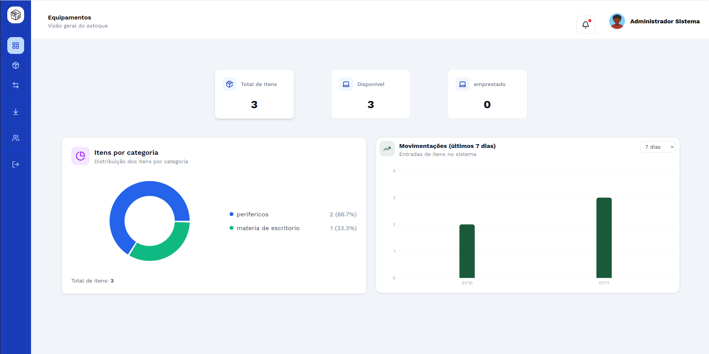
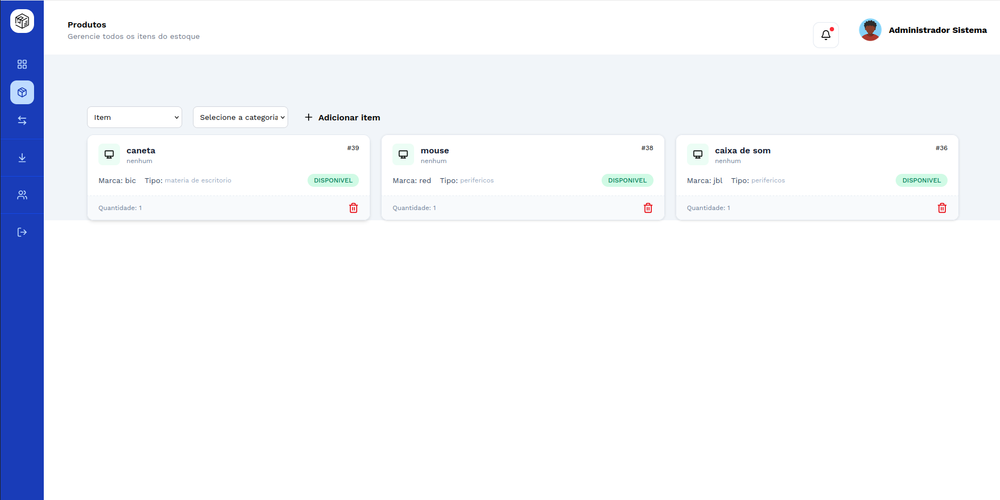
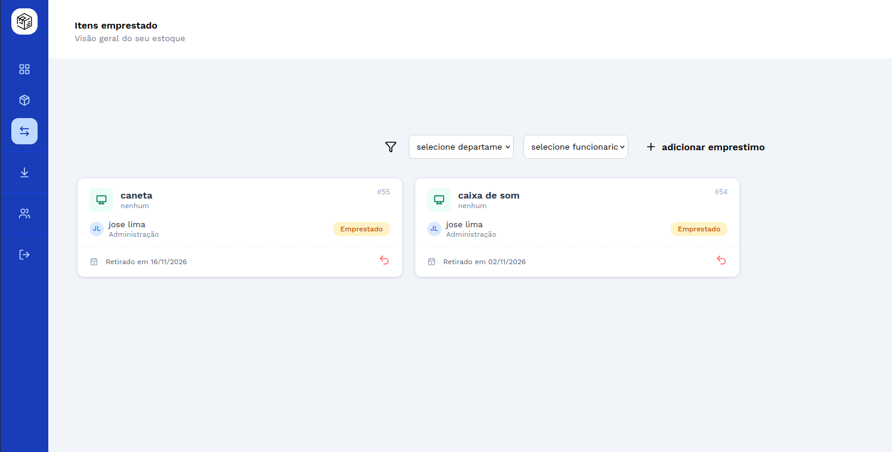

<div align="center">

# 📦 EstoqueApp

**Sistema web para controle de estoque, empréstimos e patrimônio de equipamentos.**


</div>

---

## 📖 Sobre o projeto

O **EstoqueApp** nasceu para resolver um problema comum em equipes de TI: saber **o que existe em estoque, quem está com cada equipamento e quando ele deve voltar**.

A aplicação centraliza o cadastro de produtos, funcionários e departamentos, registra entradas, saídas e empréstimos, e entrega tudo em um dashboard com indicadores e alertas de devolução.

### Problemas que resolve

- Equipamentos emprestados sem registro de responsável.
- Falta de histórico de entradas e saídas.
- Dificuldade em identificar empréstimos em atraso.
- Controle de patrimônio feito em planilhas dispersas.

---

## 📸 Capturas de tela

> Substitua os caminhos abaixo pelas imagens reais em `docs/screenshots/`.

| Dashboard | Produtos |
|:---------:|:--------:|
|  |  |

| Empréstimos | Movimentações |
|:-----------:|:-------------:|
|  |  |

---

## ✨ Funcionalidades

### 📦 Estoque
- [x] Cadastro, edição e remoção de produtos
- [x] Organização por categorias
- [x] Controle de disponibilidade e status
- [x] Histórico de movimentações (entradas e saídas)

### 👥 Funcionários e departamentos
- [x] Cadastro e gerenciamento de funcionários
- [x] Vínculo com departamentos
- [x] Consulta de equipamentos por departamento
- [x] Identificação do responsável por cada empréstimo

### 🔄 Empréstimos
- [x] Registro de empréstimos para funcionários
- [x] Datas de retirada e previsão de devolução
- [x] Registro de devolução
- [x] Destaque para empréstimos próximos do vencimento ou em atraso

### 📊 Dashboard
- [x] Visão geral do estoque
- [x] Indicadores por categoria
- [x] Histórico de entradas e saídas
- [x] Resumo de empréstimos, devoluções e pendências

---

## 🛠️ Tecnologias

| Camada | Tecnologia | Uso |
|--------|-----------|-----|
| Frontend | React.js | Interface do usuário |
| Frontend | Tailwind CSS | Estilização |
| Backend | Node.js + Express.js | API REST e regras de negócio |
| Banco de dados | MySQL | Armazenamento relacional |
| Infraestrutura | Docker | Containerização dos serviços |
| Infraestrutura | Nginx | Reverse proxy |

---

## 🏗️ Arquitetura

```text
            USUÁRIO
               │
               ▼
             NGINX  (reverse proxy)
               │
        ┌──────┴──────┐
        ▼             ▼
    FRONTEND       BACKEND
     React        Node + Express
                      │
                      ▼
                    MySQL
```

- **Frontend:** consome a API REST e exibe dados e indicadores.
- **Backend:** valida requisições, aplica regras de negócio e acessa o banco.
- **Banco de dados:** guarda produtos, funcionários, departamentos, empréstimos e histórico.
- **Nginx + Docker:** todos os serviços sobem em containers, com um único ponto de entrada.

---

## 🚀 Como executar

**Pré-requisitos:** [Docker](https://docs.docker.com/get-docker/) e Docker Compose.

```bash
# 1. Clone o repositório
git clone https://github.com/<seu-usuario>/EstoqueApp.git
cd EstoqueApp

# 2. Configure as variáveis de ambiente
cp .env.example .env

# 3. Suba os containers
docker compose up -d --build
```

Depois, crie o usuário administrador e finalize a configuração seguindo o
📖 **[Manual de Instalação (INSTALL.md)](INSTALL.md)**.

---

## 🔐 Segurança

- Autenticação com **JWT**
- Validação de dados no frontend e no backend
- Credenciais gerenciadas por variáveis de ambiente (nunca versionadas)
- Serviços isolados em containers Docker

---

## 📁 Estrutura do projeto

```text
EstoqueApp/
├── frontend/            # Aplicação React
├── backend/             # API Node.js + Express
├── nginx/               # Configuração do reverse proxy
├── docs/
│   └── screenshots/     # Imagens usadas neste README
├── docker-compose.yml
├── .env.example
├── INSTALL.md
└── README.md
```

---

## 🗺️ Próximos passos

- [ ] Relatórios exportáveis (PDF/Excel)
- [ ] Notificações de devolução por e-mail
- [ ] Perfis de acesso com permissões diferentes
- [ ] Testes automatizados


---

## 🎯 Objetivo

Oferecer uma solução prática para controle de ativos e equipamentos, com **rastreabilidade das movimentações** e **responsabilidade clara** sobre cada item emprestado.

O projeto também é uma aplicação prática de desenvolvimento Full Stack, APIs REST, bancos relacionais, containerização e deploy de aplicações web.

---

## 👨‍💻 Autor

**Guilherme Meireles Lima**
Desenvolvedor com interesse em React, Node.js, Java e infraestrutura de TI.

[](https://linkedin.com/in/<seu-perfil>)
[](https://github.com/<seu-usuario>)
